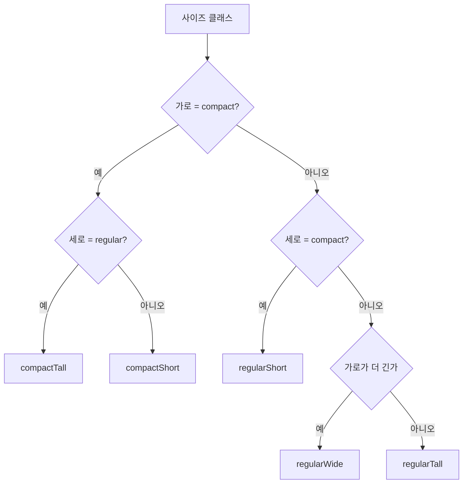

# 적응형 레이아웃 설계 가이드

2026-09-20 기준

나열한 13개 케이스는 **(가로 사이즈 클래스, 세로 사이즈 클래스, 가로가 세로보다 긴가)** 세 값으로 전부 분류되고, 그 결과는 5개 쉐이프로 줄어듭니다. 기기를 알아내는 신호들은 따로 있지만, 레이아웃 분기에는 쓰면 안 됩니다.

---

## 결론 — 신호를 3계층으로 갈라 쓴다

Apple HIG가 명시하는 원칙입니다. "레이아웃은 사이즈 클래스로 결정하고, 기기 타입이나 방향으로 결정하지 말 것. 기기의 방향과 idiom은 사용 가능한 공간이 얼마인지 알려주지 않기 때문에 레이아웃 판단에 유용하지 않다."

그래서 신호를 세 계층으로 나누고, **계층끼리 섞지 않는 것**이 이 가이드의 전체 주장입니다.

| 계층 | 신호 | 결정하는 것 |
| --- | --- | --- |
| **L1 · 레이아웃 분기** | 가로·세로 사이즈 클래스, 뷰의 실제 크기와 종횡비 | 몇 컬럼인가, 사이드바를 펼칠가, 스택을 가로로 둘까 세로로 둘까 |
| **L2 · 공간 보정** | 세이프 에어리어 인셋, 레이아웃 마진, 예약 영역(접힘·카메라), `toolbarVerticalEdge` | 어디부터 그려도 안전한가, 무엇을 비켜야 하는가 |
| **L3 · 플랫폼 관례와 능력** | idiom, macCatalyst, `isiOSAppOnMac`, 힌지 존재, 멀티 씬 가능 여부 | 무엇을 **할 수 있는가** (새 창, 카메라, 세로 바). 얼마나 넓은지는 결정하지 않음 |

### 기존 방식에서 무엇이 바뀌나

지금까지 쓰시던 window 크기 직접 분기는 **L1의 일부만 쓰고 L1의 나머지를 버린 방식**입니다. 폭 780pt라는 숫자 하나로는 그게 iPad 절반 창인지, Mac의 좁은 창인지, Duo 내부 화면인지 구분되지 않고, 새 폼팩터가 나올 때마다 브레이크포인트를 다시 잡아야 합니다.

사이즈 클래스는 시스템이 "이 공간에서는 이런 경험을 줘야 한다"고 미리 판단해 둔 값입니다. 기기가 늘어나도 값의 의미는 그대로입니다.

### 다만 사이즈 클래스만으로는 부족합니다

조합이 네 가지뿐이라 regular × regular 안에 iPad 가로, iPad 세로, Duo 내부 가로, Duo 내부 세로, Mac 창이 전부 들어옵니다. 그래서 **종횡비**를 한 축 더 씁니다.

```swift
let isWide = size.width > size.height
```

이 셋 — `hSizeClass`, `vSizeClass`, `isWide` — 으로 13개 케이스가 5개 쉐이프로 정리됩니다. 더 세밀한 조정이 필요하면 브레이크포인트 대신 **연속적인 폭**을 써서 컬럼 수를 계산하세요 (`LazyVGrid`의 `.adaptive(minimum:)`처럼).

### 분기 자체를 줄이는 쪽이 먼저

분기 코드를 잘 짜는 것보다, 분기가 필요 없게 만드는 쪽이 항상 낫습니다.

- `NavigationSplitView` / `TabView` — 사이즈 클래스에 맞춰 알아서 접히고 펼쳐집니다
- `ViewThatFits` — 들어가는 레이아웃을 시스템이 고릅니다
- `AnyLayout(HStackLayout())` ↔ `AnyLayout(VStackLayout())` — 상태와 애니메이션을 유지한 채 축만 바꿉니다
- `LazyVGrid(columns: [GridItem(.adaptive(minimum: 320))])` — 컬럼 수를 폭이 결정합니다

직접 분기는 이들로 안 되는 곳에만 쓰세요.

---

## 쓸 수 있는 신호 전부

### L1 — 레이아웃 분기용

| 신호 | SwiftUI | UIKit | 값 |
| --- | --- | --- | --- |
| 가로 사이즈 클래스 | `@Environment(\.horizontalSizeClass)` | `traitCollection.horizontalSizeClass` | `.compact` / `.regular` |
| 세로 사이즈 클래스 | `@Environment(\.verticalSizeClass)` | `traitCollection.verticalSizeClass` | `.compact` / `.regular` |
| 뷰 크기 | `GeometryReader` / `onGeometryChange` | `view.bounds` · `viewWillTransition` | `CGSize` |
| 종횡비 | `size.width > size.height` | 동일 | `Bool` |

사이즈 클래스는 **기기가 아니라 뷰/씬의 속성**입니다. 사이드바 안쪽 컴포넌트는 부모가 regular여도 자기는 compact로 읽힐 수 있습니다. 그게 의도된 동작입니다.

`GeometryReader`는 레이아웃을 가로채기 방식으로 바꿔버리므로, 값만 필요하면 iOS 18+의 `onGeometryChange`를 쓰세요.

```swift
.onGeometryChange(for: CGSize.self) { $0.size } action: { size in
    self.size = size
}
```

### L2 — 공간 보정용

| 신호 | API | 의미 |
| --- | --- | --- |
| 세이프 에어리어 | `proxy.safeAreaInsets` · `view.safeAreaInsets` | 시스템 UI·하드웨어가 가리는 영역. **비대칭이 기본** |
| 접힘 (활성) | `reservedRegions(kind: .division)` | 지금 부분적으로 접혀 있다. 비어 반환 = 접힘 없음 |
| 접힘 (잠재) | `reservedRegions(kind: .division, options: .includeInactive)` | 접힐 수 있는 기기다. 펼쳐지면 너비 0 |
| 카메라 가림 | `reservedRegions(kind: .occlusion)` | 내부 카메라가 겹쳐서 일부를 가림 |
| 세로 바 여부 | `@Environment(\.toolbarVerticalEdge)` · `traitCollection.verticalBarEdge` | nil이 아니면 바가 세로로 놓일 수 있는 상황 |

예약 영역은 iOS 27.1에서 추가됐습니다. `.includeInactive`로 조회한 division 영역이 **사실상 유일한 "이 기기는 접힌다" 신호**이면서 동시에 레이아웃 정보이기도 합니다. 그래서 L1과 L3 경계에 걸쳐 있는 유일한 신호입니다.

```swift
GeometryReader { proxy in
    let folds  = proxy.reservedRegions(kind: .division)
    let canFold = !proxy.reservedRegions(kind: .division,
                                         options: .includeInactive).isEmpty
    // folds.isEmpty == false  -> 지금 책처럼 접혀 있다
    // canFold == true         -> iPhone Duo 계열 기기다
}
```

### L3 — 플랫폼 관례·능력용 (레이아웃 분기 금지)

| 신호 | API | 값과 주의 |
| --- | --- | --- |
| idiom | `UIDevice.current.userInterfaceIdiom` | `.phone` / `.pad` / `.mac`. Catalyst는 "Optimize for Mac"이면 `.mac`, "Scaled to match iPad"면 `.pad` |
| Catalyst 여부 | `#if targetEnvironment(macCatalyst)` | 컴파일 시점 분기 |
| Apple Silicon Mac의 iOS 앱 | `ProcessInfo.processInfo.isiOSAppOnMac` | Catalyst가 아닌 경로. idiom은 `.pad` 또는 `.phone` |
| 힌지 존재 | `onHingeChange`의 `context.hinge != nil` | nil이면 힌지 없는 기기 |
| 힌지 상태 | `hinge.status` | `.closed` / `.partiallyOpen` / `.fullyOpen` |
| 멀티 씬 | `UIApplication.shared.supportsMultipleScenes` | Duo 외부 화면에서는 실제 생성이 실패함 |

### 쓰면 안 되는 것

| 신호 | 이유 |
| --- | --- |
| `UIScreen.main` | 디스플레이가 둘인 기기에서 모호하고 향후 지원 중단 예정. 필요하면 `windowScene.screen` |
| `interfaceOrientation` 로 레이아웃 분기 | **Duo 내부 디스플레이는 앱이 지원하는 방향을 따르지 않음.** 값이 의미 없음 |
| idiom 으로 레이아웃 분기 | 같은 idiom 안에 전체화면부터 1/3 창까지 다 들어있음 |
| 힌지 각도로 레이아웃 분기 | Apple 명시: 힌지는 인터랙션·효과용. 레이아웃은 arrangement와 region API |
| 하드코딩된 브레이크포인트 | 새 폼팩터마다 깨짐. 연속적인 폭 계산으로 대체 |

---

## 케이스 × 신호 매트릭스

`H`/`V` = 가로·세로 사이즈 클래스, `W` = 가로가 세로보다 길다. ✓ 는 Apple 문서·영상으로 확인된 값, ? 는 시뮬레이터 실측이 필요한 값입니다.

### 고정 케이스

| 케이스 | H | V | W | 접힘 | 쉐이프 |
| --- | --- | --- | --- | --- | --- |
| 아이폰 세로 | C | R | ✗ | — | `.compactTall` ✓ |
| 아이폰 가로 (일반) | C | C | ✓ | — | `.compactShort` ✓ |
| 아이폰 가로 (Plus·Max) | **R** | C | ✓ | — | `.regularShort` ✓ |
| Duo 외부 세로 | C | R | ✗ | — | `.compactTall` ✓ |
| Duo 외부 가로 | C | **C** | ✓ | — | `.compactShort` ✓ |
| Duo 내부 가로로 펼침 | R | R | ✓ | 비활성 | `.regularWide` ✓ |
| Duo 내부 펼쳐서 세로로 | R | R | ✗ | 비활성 | `.regularTall` ✓ |
| 아이패드 세로 | R | R | ✗ | 없음 | `.regularTall` ✓ |
| 아이패드 가로 | R | R | ✓ | 없음 | `.regularWide` ✓ |
| 아이패드 슬라이드 오버 | C | R | ✗ | 없음 | `.compactTall` ✓ |

나열한 "아이폰 가로모드"는 사실 **두 개**입니다. Plus·Max 계열은 가로에서 regular width가 되어 사이드바나 2컬럼이 열립니다. 반면 **Duo 외부 가로는 넓은데도 compact width**로 유지됩니다. 이 둘을 같은 코드로 묶으려고 폭 숫자로 분기했다면 바로 깨집니다.

### 가변 케이스

| 케이스 | 나올 수 있는 쉐이프 | 식별 |
| --- | --- | --- |
| 아이패드 스플릿뷰 | 좁은 쪽 `.compactTall`, 넓은 쪽 `.regularTall`/`.regularWide` | 연속적으로 변함 ✓ |
| 아이패드 창 크기 조정 | 5개 전부 | 연속적 ✓ |
| 맥 창 크기 조정 (Catalyst) | `.regularWide` ↔ `.regularTall` 위주 | Catalyst는 좁혀도 regular 유지되는 것으로 알려져 있음 ? |
| iPhone Mirroring | 5개 전부 | idiom `.phone` + 자유 리사이즈 ✓ |
| Duo 스플릿뷰 (내부 50/50) | `.compactTall` 추정 | 내부가 regular였다 해도 절반이면 compact로 떨어질 가능성이 높음 ? |
| Duo 동영상 PiP + 앱 | 높이가 실시간으로 변함 | 접으면 영상이 절반을 차지함 ✓ |

가변 케이스에서 중요한 건 "어느 쉐이프가 되느냐"가 아니라 **모든 쉐이프가 될 수 있다고 가정하는 것**입니다. HIG도 같은 말을 합니다 — "가능한 모든 사이즈 클래스 조합을 고려하라."

### 놓친 케이스

레이아웃 쉐이프는 위 5개가 전부지만, **같은 쉐이프 안에서 추가로 대응해야 하는 상태**가 있습니다.

| 상태 | 신호 | 무엇을 바꿔야 하나 |
| --- | --- | --- |
| Duo를 책처럼 부분 접음 | `.division` 활성 | 접힘선을 가로지르는 요소를 한쪽 영역으로 옮김 |
| 테이블에 세워둔 자세 | `.division` 활성 + `.regularTall` | 상단 미디어 / 하단 컨트롤 (선택) |
| 내부 카메라 활성 | `.occlusion` | 그 프레임을 피해 중요 요소 배치 |
| 바가 세로로 바뀜 | `toolbarVerticalEdge != nil` | 커스텀 바 항목의 메트릭 조정 |
| 세이프 에어리어가 비대칭 | `safeAreaInsets.leading != .trailing` | 양변 같다고 가정한 계산 제거 |
| 모드·접근성 | Dynamic Type, 투명도 감소 | 텍스트가 커지면 가로 배치를 세로로 |

이들은 쉐이프와 **직교하는 축**입니다. 쉐이프 enum에 섞어넣지 말고 별도 프로퍼티로 두세요.

---

## 구분되지 않는 케이스들

매트릭스를 보면 서로 다른 기기가 같은 칸에 들어갑니다. 이건 정보가 부족한 게 아니라 **같게 다루라는 설계**입니다.

| 쉐이프 | 같이 들어오는 것들 |
| --- | --- |
| `.compactTall` | 아이폰 세로 · Duo 외부 세로 · 아이패드 슬라이드 오버 · 아이패드·맥의 좁은 창 · Duo 스플릿뷰 |
| `.compactShort` | 아이폰 가로(일반) · Duo 외부 가로 |
| `.regularShort` | 아이폰 Plus·Max 가로 · 낮고 넓게 줄인 창 |
| `.regularTall` | 아이패드 세로 · Duo 내부 세로 |
| `.regularWide` | 아이패드 가로 · Duo 내부 가로 · 맥 창 |

### 왜 구분하면 안 되나

**1. 기능이 달라지면 안 됩니다.** HIG의 문장입니다 — "앱이 차지하는 공간에 따라 기능을 바꾸지 말 것. 다만 화면에 보이는 기능의 양은 바꿀 수 있다." 기기로 분기하기 시작하면 기능 차이로 번집니다.

**2. 사용자가 수시로 오갑니다.** Duo는 하루에도 수십 번 열리고 닫힙니다. 내부와 외부의 계층 구조가 다르면 그때마다 다시 길을 찾아야 합니다.

**3. 조합이 폭발합니다.** 13개 케이스를 각각 다루면 다음 폼팩터가 나올 때 14번째를 추가해야 하고, 그 사이 리사이즈 구간은 여전히 비어 있습니다. 쉐이프는 5개에서 멈춥니다.

### 자주 나오는 함정

| 하고 싶어지는 것 | 어디서 깨지나 |
| --- | --- |
| "아이패드니까 2컬럼" | 슬라이드 오버·좁은 스플릿뷰에서 짓뭉개짐 |
| "폭 780pt니까 사이드바" | 맥에서 창을 줄이면 사이드바가 사라짐. Duo 내부에서는 안 나타남 |
| "가로모드니까 옆으로 배치" | Plus·Max와 일반 아이폰이 같은 가로에서 다른 사이즈 클래스 |
| "Duo니까 특별한 화면" | 사용자가 접으면 그 화면이 사라짐 |

### 그럼 실제 크기 차이는 어떻게 하나

아이패드 가로와 Duo 내부 가로는 같은 `.regularWide`지만 실제 폭은 다릅니다. 여기서 규칙을 하나 세우면 깔끔해집니다.

> **구조는 쉐이프가 결정하고, 밀도는 연속적인 폭이 결정한다.**

사이드바를 열지 말지, 스택을 쌓을지 나란히 둘지 — 이건 쉐이프의 일입니다. 그리드가 3컬럼인지 5컬럼인지, 카드 한 장이 몇 pt인지 — 이건 폭의 일입니다.

```swift
// 구조: 쉐이프
switch context.shape {
case .compactTall, .compactShort:
    StackLayout()
case .regularShort, .regularTall, .regularWide:
    SplitLayout()
}

// 밀도: 연속적인 폭
LazyVGrid(columns: [GridItem(.adaptive(minimum: 320, maximum: 480))]) { … }
```

---

## 그래도 기기를 알아야 하는 지점

L3를 써도 되는 곳이 있습니다. 공통점은 전부 **"얼마나 넓은가"가 아니라 "무엇을 할 수 있는가"**를 묻는다는 점입니다.

| 지점 | 쓰는 신호 | 해야 할 일 |
| --- | --- | --- |
| 새 창 열기 | 생성 실패 가능성 | Duo 외부 화면에서는 불가. `UIWindowSceneActivationAction`은 불가할 때 자동으로 숨음 |
| 씬 액세서리 | `CameraCaptureAccessory` | Duo 전용. 사용 가능 여부를 `onAvailabilityChange`로 관찰해 버튼을 비활성화 |
| 카메라 전환 | 디바이스 타입 | 가상 전면 카메라면 자동. 개별 카메라면 `AVCaptureDeviceDirectionCoordinator` |
| 힌지 인터랙션 | `context.hinge` | 효과용만. nil이면 조용히 아무것도 안 함 |
| 맥 창 관례 | macCatalyst | 하단 가장자리에 중요 컨트롤 금지(창을 화면 밖으로 내리는 사용자가 많음), 카메라 하우징 뒤 콘텐츠 금지 |
| 창 최소 크기 | `windowScene.sizeRestrictions` | 리사이즈를 막는 용도가 아니라 겹침 방지용으로만 |

### 원칙: 능력으로 묻고, 항상 폴백을 둔다

```swift
// 이러지 말 것
if UIDevice.current.userInterfaceIdiom == .pad {
    openInNewWindow()
}

// 이렇게 — 능력을 묻고, 안 되면 사라지게
ToolbarItem {
    UIWindowSceneActivationAction(…)   // 불가하면 자동으로 숨음
}
```

기기를 물으면 새 기기가 나올 때마다 코드를 고쳐야 합니다. 능력을 물으면 시스템이 알아서 답합니다.

### idiom은 언제 쓰나

HIG가 딱 한 가지 용도를 남겨둡니다. "사이즈 클래스는 바뀌더라도 idiom — 그 앱이 만들어진 기기 유형 — 은 그대로이다. 리사이즈해도 레이아웃은 그 플랫폼답게 유지하라."

즉 idiom은 **크기가 아니라 톤을 결정**합니다. 맥에서 창을 아이폰만하게 줄였다고 아이폰 UI가 되면 안 됩니다. 레이아웃은 좁아지되 맥 앱으로 보여야 합니다.

---

## LayoutContext 구현

### 쉐이프

```swift
import SwiftUI

enum LayoutShape: Equatable {
    case compactTall    // C x R — 아이폰 세로, Duo 외부 세로, 슬라이드 오버
    case compactShort   // C x C — 아이폰 가로(일반), Duo 외부 가로
    case regularShort   // R x C — 아이폰 Plus/Max 가로, 낮고 넓은 창
    case regularTall    // R x R, 세로가 김 — 아이패드 세로, Duo 내부 세로
    case regularWide    // R x R, 가로가 김 — 아이패드 가로, Duo 내부 가로, 맥

    init(h: UserInterfaceSizeClass?,
         v: UserInterfaceSizeClass?,
         isWide: Bool) {
        switch (h ?? .regular, v ?? .regular) {
        case (.compact, .regular): self = .compactTall
        case (.compact, .compact): self = .compactShort
        case (.regular, .compact): self = .regularShort
        case (.regular, .regular): self = isWide ? .regularWide : .regularTall
        @unknown default:          self = .regularWide
        }
    }

    /// 단일 컬럼으로 가야 하는가
    var prefersSingleColumn: Bool {
        self == .compactTall || self == .compactShort
    }
}
```

### 컨텍스트

```swift
struct LayoutContext: Equatable {
    // L1 — 분기용
    var shape: LayoutShape = .regularWide
    var size: CGSize = .zero

    // L2 — 보정용
    var safeArea: EdgeInsets = EdgeInsets()
    var foldFrames: [CGRect] = []        // 지금 활성인 접힘
    var canFold: Bool = false            // 접힐 수 있는 기기인가
    var occlusionFrames: [CGRect] = []   // 내부 카메라가 가리는 영역

    var isFolded: Bool { !foldFrames.isEmpty }
    var isWide: Bool { size.width > size.height }
    var hasAsymmetricSafeArea: Bool { safeArea.leading != safeArea.trailing }
}
```

L3(idiom, Catalyst, 힌지)는 **일부러 넣지 않았습니다.** 컨텍스트에 있으면 결국 분기에 쓰이게 됩니다. 필요한 곳에서 그 자리에서 직접 물으세요.

### 측정과 주입

```swift
extension EnvironmentValues {
    @Entry var layoutContext = LayoutContext()
}

private struct LayoutContextModifier: ViewModifier {
    @Environment(\.horizontalSizeClass) private var h
    @Environment(\.verticalSizeClass) private var v
    @State private var probe = Probe()

    struct Probe: Equatable {
        var size: CGSize = .zero
        var safeArea = EdgeInsets()
        var foldFrames: [CGRect] = []
        var canFold = false
        var occlusionFrames: [CGRect] = []
    }

    func body(content: Content) -> some View {
        content
            .onGeometryChange(for: Probe.self) { proxy in
                var p = Probe(size: proxy.size, safeArea: proxy.safeAreaInsets)
                if #available(iOS 27.1, *) {
                    p.foldFrames = proxy
                        .reservedRegions(kind: .division).map(\.frame)
                    p.canFold = !proxy
                        .reservedRegions(kind: .division,
                                         options: .includeInactive).isEmpty
                    p.occlusionFrames = proxy
                        .reservedRegions(kind: .occlusion).map(\.frame)
                }
                return p
            } action: { probe = $0 }
            .environment(\.layoutContext, context)
    }

    private var context: LayoutContext {
        LayoutContext(
            shape: LayoutShape(h: h, v: v,
                               isWide: probe.size.width > probe.size.height),
            size: probe.size,
            safeArea: probe.safeArea,
            foldFrames: probe.foldFrames,
            canFold: probe.canFold,
            occlusionFrames: probe.occlusionFrames
        )
    }
}

extension View {
    func measureLayoutContext() -> some View {
        modifier(LayoutContextModifier())
    }
}
```

`onGeometryChange`는 iOS 18+입니다. 그 이전을 지원해야 하면 `GeometryReader`를 배경에 깔고 `onChange`로 옮기세요.

### 쓰는 쪽

```swift
@main
struct TiTiApp: App {
    var body: some Scene {
        WindowGroup {
            RootView().measureLayoutContext()
        }
    }
}

struct RecordView: View {
    @Environment(\.layoutContext) private var layout

    var body: some View {
        if layout.shape.prefersSingleColumn {
            SingleColumn()
        } else {
            TwoColumn()
        }
    }
}
```

### 중요한 함정 하나

루트에서 측정한 컨텍스트는 **씬 전체의 모양**입니다. 사이드바 안쪽이나 스플릿 뷰의 한 컬럼 안에 있는 컴포넌트는 자기 폭이 따로 있고, 시스템이 그 컴포넌트에 compact 사이즈 클래스를 내려주기도 합니다.

- 화면 전체 구조를 정하는 최상위 뷰 → 주입된 `layoutContext`
- 컬럼·카드 안의 재사용 컴포넌트 → 자기 자신의 `@Environment(\.horizontalSizeClass)` 또는 `containerRelativeFrame`

둘을 섞으면 사이드바 안에서 아이패드 레이아웃이 그려지는 버그가 납니다.

---

## 쉐이프 5개로 묶기

분기 결정은 이 순서로만 내리면 됩니다.



### 쉐이프별 권장 구조

| 쉐이프 | 탐색 | 본문 | 주의할 점 |
| --- | --- | --- | --- |
| `.compactTall` | 탭 바 · `NavigationStack` | 단일 컬럼 | 가장 좁은 기준. 여기서 동작하면 나머지는 여유가 생길 뿐 |
| `.compactShort` | 탭 바(세로로 갈 수 있음) | 단일 컬럼, 세로 공간 절약 | 헤더·여백을 줄이고 스크롤을 믿는다 |
| `.regularShort` | 사이드바 가능 | 2컬럼, 낮게 | 세로가 짧으므로 세로 스크롤 길이를 줄이지 말 것 |
| `.regularTall` | 사이드바 또는 탭 바 | 1~2컬럼 + 세로 스크롤 | 넓이를 다 쓰지 말고 가독 폭 제한 |
| `.regularWide` | 사이드바 | 2~3컬럼 또는 스플릿 | 가장 넓은 기준. 빈 공간 방지 |

### 설계 단계에서는 3개로 좁혀도 됩니다

디자인 시안을 5개 그리는 건 과합니다. 실제로 그려야 하는 건 보통 세 가지입니다.

| 모드 | 쉐이프 | 설명 |
| --- | --- | --- |
| **stack** | `.compactTall`, `.compactShort` | 한 번에 한 화면. 푸시로 깊이 이동 |
| **split** | `.regularShort`, `.regularTall` | 목록 + 상세를 동시에 |
| **expanded** | `.regularWide` | 사이드바 + 목록 + 상세 |

단, **코드에서는 5개를 유지**하세요. 나중에 `.compactShort`만 다르게 다뤄야 할 일이 생기면 분해하기 쉬워야 하니까요.

```swift
extension LayoutShape {
    enum Presentation { case stack, split, expanded }

    var presentation: Presentation {
        switch self {
        case .compactTall, .compactShort:   .stack
        case .regularShort, .regularTall:   .split
        case .regularWide:                  .expanded
        }
    }
}
```

### 다음 단계 — 화면별 매핑

이제 서비스 화면을 이 세 모드에 올리면 됩니다. 화면마다 이 표를 생각해보세요.

| 화면 | stack | split | expanded |
| --- | --- | --- | --- |
| (예) 기록 목록 | 목록만, 탭하면 푸시 | 왼쪽 목록 + 오른쪽 상세 | 사이드바(기간) + 목록 + 상세 |
| (예) 타이머 | 전체 화면 | 타이머 + 오늘 기록 | 타이머 + 기록 + 통계 |

이때 꼭 지킬 것은 하나입니다. **세 모드가 담는 기능의 집합은 같아야 합니다.** 한 번에 보이는 양만 달라지고, stack에서도 푸시하거나 시트를 올려서 도달할 수 있어야 합니다.

---

## 실측 도구

매트릭스의 `?` 를 직접 메꾸는 방법입니다. 디버그 빌드에 오버레이를 깔고 시뮬레이터를 돌면서 값을 적어 넣으세요.

```swift
#if DEBUG
struct LayoutProbeOverlay: View {
    @Environment(\.layoutContext) private var layout
    @Environment(\.horizontalSizeClass) private var h
    @Environment(\.verticalSizeClass) private var v

    var body: some View {
        VStack(alignment: .leading, spacing: 2) {
            row("shape", "\(layout.shape)")
            row("size",  "\(Int(layout.size.width))x\(Int(layout.size.height))")
            row("class", "\(label(h))/\(label(v))")
            row("wide",  layout.isWide ? "Y" : "N")
            row("safe",  "L\(Int(layout.safeArea.leading))"
                       + " T\(Int(layout.safeArea.top))"
                       + " R\(Int(layout.safeArea.trailing))"
                       + " B\(Int(layout.safeArea.bottom))")
            row("fold",  layout.canFold
                         ? (layout.isFolded ? "folded" : "capable") : "-")
            row("occl",  "\(layout.occlusionFrames.count)")
            row("idiom", "\(UIDevice.current.userInterfaceIdiom.rawValue)")
        }
        .font(.system(size: 10, design: .monospaced))
        .padding(6)
        .background(.black.opacity(0.7), in: .rect(cornerRadius: 6))
        .foregroundStyle(.white)
        .allowsHitTesting(false)
    }

    private func row(_ k: String, _ vv: String) -> some View {
        HStack(spacing: 6) {
            Text(k).foregroundStyle(.white.opacity(0.6))
            Text(vv)
        }
    }

    private func label(_ c: UserInterfaceSizeClass?) -> String {
        switch c {
        case .compact: "C"
        case .regular: "R"
        default:       "?"
        }
    }
}
#endif
```

루트에 붙입니다.

```swift
RootView()
    .measureLayoutContext()
    #if DEBUG
    .overlay(alignment: .topLeading) {
        LayoutProbeOverlay().padding(8)
    }
    #endif
```

`toolbarVerticalEdge`는 iOS 27.1 전용이라 위 오버레이에서 뺀 상태입니다. 필요하면 `@available(iOS 27.1, *)` 하위 뷰로 분리해 붙이세요.

### 돌려볼 구성

순서대로 하면 한 번에 끝납니다.

- [ ] iPhone 일반 구형 — 세로 / 가로
- [ ] iPhone Pro Max — 세로 / 가로 (가로에서 R이 나오는지 확인)
- [ ] iPhone Duo — 닫음 세로 / 닫음 가로
- [ ] iPhone Duo — 펼침 가로 / 펼침 세로
- [ ] iPhone Duo — 부분적으로 접음 (fold 값이 folded로 바뀌는지)
- [ ] iPhone Duo — 스플릿뷰 왼쪽 / 오른쪽 (safe 값이 비대칭인지)
- [ ] iPad — 세로 / 가로 / 슬라이드 오버 / 스플릿뷰 양쪽
- [ ] iPad — 창을 연속적으로 리사이즈하며 쉐이프가 몇 번 바뀌는지
- [ ] Mac Catalyst — 최대 / 최소 크기 (compact로 떨어지는지 확인)
- [ ] iPhone Mirroring — 리사이즈

특히 이 세 가지는 가정하지 말고 꼭 실측하세요.

1. **Duo 스플릿뷰에서 가로 사이즈 클래스** — compact가 되는지
2. **Catalyst 창을 좁혔을 때** — regular을 유지하는지
3. **Duo 외부 화면에서 canFold** — true인지 (외부엔 접힘이 없으니 false일 수도 있습니다)

3번이 false라면 "이 기기가 Duo다"를 예약 영역으로는 알 수 없고, 힌지 존재 여부로만 알 수 있다는 뜻입니다. 다행히 레이아웃에서는 그걸 알 필요가 없습니다.

---

## 기존 분기에서 옮겨가기

### 1. 현재 분기 지점 찾기

```bash
rg -n "UIScreen\.main|userInterfaceIdiom|interfaceOrientation|isPortrait|isLandscape" --type swift
```

```bash
rg -n "\.width [<>]=?|\.height [<>]=?" --type swift
```

### 2. 분기를 두 종류로 분류하기

찾은 것들을 하나씩 집어서 물어보세요.

| 질문 | 예시 | 옮겨갈 곳 |
| --- | --- | --- |
| 화면 **구조**가 바뀌나 | 사이드바 유무, 1컬럼↔2컬럼, 스택 방향 | `LayoutShape` |
| 요소 **밀도**만 바뀌나 | 그리드 컬럼 수, 카드 폭, 폰트 크기 | 연속적인 폭 / `.adaptive` |
| 둘 다 아니다 | 디바이스별 기능 차이 | 제거 — 기능은 바뀌면 안 됨 |

세 번째가 나오면 그건 레이아웃 문제가 아니라 설계 문제입니다. 먼저 해결하세요.

### 3. 치환 패턴

```swift
// Before — 폭 숫자로 직접 분기
if geometry.size.width > 700 {
    HStack { list; detail }
} else {
    list
}

// After — 구조는 쉐이프가
if layout.shape.prefersSingleColumn {
    list
} else {
    HStack { list; detail }
}
```

```swift
// Before — 디바이스로 컬럼 수 결정
let columns = isPad ? 4 : 2

// After — 밀도는 폭이
LazyVGrid(columns: [GridItem(.adaptive(minimum: 160))]) { … }
```

```swift
// Before — 방향으로 축 결정
if isLandscape { HStack { … } } else { VStack { … } }

// After — 상태와 애니메이션을 유지하며 축만 교체
let layoutKind = layout.isWide
    ? AnyLayout(HStackLayout())
    : AnyLayout(VStackLayout())

layoutKind { … }
```

### 4. 프리뷰 세트 만들기

화면마다 다섯 개를 깔아두면 회귀가 바로 보입니다.

```swift
#Preview("compactTall") {
    RecordView()
        .environment(\.horizontalSizeClass, .compact)
        .environment(\.verticalSizeClass, .regular)
        .frame(width: 390, height: 844)
}

#Preview("regularWide") {
    RecordView()
        .environment(\.horizontalSizeClass, .regular)
        .environment(\.verticalSizeClass, .regular)
        .frame(width: 1180, height: 820)
}
```

environment를 강제로 바꿔도 실제 컨테이너 크기는 그대로라, `frame`을 같이 줘야 쉐이프 계산이 맞습니다.

### 5. 순서

한 번에 다 바꾸지 마세요. 이 순서가 가장 안전합니다.

1. `LayoutShape` / `LayoutContext` 를 추가하고 루트에 주입한다 (기존 코드는 그대로)
2. 진단 오버레이로 전체 구성을 돌려 실측표를 채운다
3. 가장 복잡한 화면 하나만 쉐이프로 옮긴다
4. 그 화면에 프리뷰 5개를 걸어 회귀를 고정한다
5. 나머지 화면을 같은 방식으로 옮긴다
6. `UIScreen.main` 과 방향·idiom 분기를 제거한다
7. Xcode의 App Resizability 를 돌려 남은 문제를 잡는다

---

## 참고 자료

| 자료 | 이 가이드에서 쓴 부분 |
| --- | --- |
| [Human Interface Guidelines — Layout](https://developer.apple.com/design/human-interface-guidelines/layout) | 사이즈 클래스 정의, "기기·방향으로 분기하지 말 것", 기능을 바꾸지 말 것, idiom은 그대로 유지 |
| [Prepare your app for iPhone Duo](https://developer.apple.com/kr/videos/play/tech-talks/111461/) | Duo의 사이즈 클래스 조합, 화면 참조 금지, 비대칭 세이프 에어리어 |
| [Strike a pose with adaptive layouts on iPhone Duo](https://developer.apple.com/kr/videos/play/tech-talks/111463/) | 예약 영역 API, `includeInactive`, ArrangementView |
| [Design for iPhone Duo](https://developer.apple.com/kr/videos/play/tech-talks/111466/) | 두 사이즈 클래스에만 집중, 내·외부 계층 일치 |
| [Leverage multiple displays and scenes on iPhone Duo](https://developer.apple.com/kr/videos/play/tech-talks/111464/) | 새 씬 생성 제약, 씬 액세서리 |
| [iPhone Duo 개발 가이드](iphone-duo-guide.md) | Duo 전체 API와 동작 정리 |

사이즈 클래스별 기기 표는 현재 HIG에서 빠졌습니다. 의도된 변화로 보입니다 — 기기 목록을 외우는 대신 실측하라는 쪽으로 가이드가 이동했고, 그래서 이 문서도 진단 오버레이를 포함했습니다.
